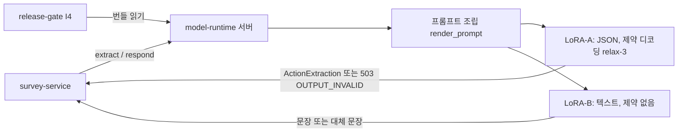

# model-runtime

문진 챗봇이 쓰는 두 개의 작은 언어 모델(LoRA-A 추출, LoRA-B 응답)을 불러와 같은 방식으로 호출해 주는 공유 라이브러리이자 추론 서버다.

환자 발화에서 "무슨 뜻인지"를 구조화해 뽑는 일(A, `extract`)과, 정해진 재료로 환자에게 할 문장을 만드는 일(B, `respond`)을 맡는다. 학습 후 평가, 승인 평가, 실제 서비스가 같은 프롬프트·디코딩으로 모델을 부르게 하는 것이 목적이다(docs/brief.md). 하지 않는 것: 학습(model-lab), 모델 보관과 승인(release-gate), 서비스 서버(survey-service), 판단 로직(turn-engine). 모델이 판단하게 만드는 프롬프트도 두지 않는다. 출처: docs/brief.md.

## 전체 속의 위치

| 이웃 | 방향 | 무엇을 | 인터페이스 |
| --- | --- | --- | --- |
| survey-service | 받음/줌 | 호출 요청을 받고 `ActionExtraction`(A) 또는 문장(B)을 돌려줌 | I9, HTTP.md I9: `POST /v1/releases/{id}/extract`, `.../respond` |
| release-gate | 받음 | 승인된 릴리스 번들(어댑터, 설정)을 읽음 | I4(`HttpReleaseReader`), `PUT /v1/releases/{id}`로 적재 |
| model-lab | 받음 | 학습된 어댑터와 모델 패키지(매니페스트) | 어댑터 디렉터리, `ModelPackageManifest` |
| boundary-contracts | 의존 | 입출력 스키마, 해시, `read_secret` | 기준 태그는 `deploy/scripts/lib.sh` (docs/boundary.md) |
| 문진 스키마 | 의존 | 정수 버전 1 확인 | `schema_dir` 읽기 전용 |

호출자가 입력 JSON의 키 순서를 지켜야 하는 등 규칙은 docs/boundary.md "호출자가 지켜야 할 것"에 있다.

## 구조

| 경로 | 역할 |
| --- | --- |
| `src/model_runtime/session.py`, `prompts.py`, `serving_config.py` | `load`, 세션(extract/respond), 프롬프트 조립, 서빙 설정과 해시 |
| `src/model_runtime/roles.py` | LoRA-A·LoRA-B 두 컴포넌트(`ExtractRole`, `RespondRole`)와 공용 재시도(ADR 0017) |
| `src/model_runtime/backends.py`, `vllm_backend.py`, `mimic.py` | 가짜 백엔드, vLLM 백엔드(제약 디코딩), 데모용 모방 백엔드(`MODEL_RUNTIME_BACKEND=mimic`, ADR 0018, 규칙표 `data/mimic_rules.json`) |
| `src/model_runtime/protection.py`, `fallback.py`, `schema_guard.py`, `errors.py` | 출력 보호, 대체 문장, 스키마 검사, 예외 |
| `src/model_runtime/server.py` | HTTP 추론 서버 |
| `profiles/` | 하드웨어별 설정: `gpu-12g.json`, `rtx4090-24g.json`, `gpu-dev-12g.json`(Qwen2.5-1.5B, 중립 어댑터·파이프라인 시험 전용, 파일의 `status`) |
| `tests/`, `scripts/` | 시험(가짜 백엔드·vLLM 모킹 포함), 스모크와 GPU 점검 스크립트 |
| `Dockerfile`, `requirements-{cpu,gpu}.lock` | 이미지 두 변형(CPU/fake, GPU/vLLM)과 잠금 파일 |



제약 디코딩 `relax-3`은 A의 출력 스키마를 xgrammar가 받을 수 있게 같은 뜻의 `anyOf`로 펼친 방식이다(docs/STATUS.md 19차). 프로파일: `gpu-12g`는 Qwen3-1.7B(파이프라인 데모용), `rtx4090-24g`는 Qwen3-8B(docs/boundary.md).

## 실행 방법

전제: 파이썬 3(venv), 시험만 할 때는 GPU 불필요. 이미지 빌드·스모크는 Docker가 필요하다. 계약 소스는 태그 기준이며, 형제 폴더 `../boundary-contracts`가 있으면 거기서 태그를 꺼내고 없으면 GitHub에서 태그를 clone한다(GitHub SSH 접근 필요). 이 리포가 쓰는 계약 태그의 정본은 `Dockerfile`의 `ARG BOUNDARY_VERSION`이다(워크스페이스 기준표 `deploy/scripts/lib.sh`와 같아야 하며, 다르면 이 파일을 고친다). GPU 실행은 NVIDIA 드라이버와 `--gpus`가 필요하다. 비밀은 값이 아니라 파일 경로(`MODEL_RUNTIME_TOKENS_FILE`, `MODEL_RUNTIME_RELEASE_TOKEN_FILE`)로 받는다(D84, docs/runbook.md).

```bash
# 1) 설치: 정본 스크립트. .venv를 만들거나 재사용하고, Dockerfile의 계약 태그로 boundary-contracts·pytest·jsonschema·-e .를 맞춘다(멱등, 형제 폴더 불필요)
bash scripts/setup-env.sh
# 2) 시험
.venv/bin/python -m pytest -q
# 3) 이미지 빌드와 스모크 (CPU/fake, 빈 포트를 Docker가 배정)
scripts/smoke.sh
# 4) 서버 (이미지 없이). 스키마 경로가 필요하다
MODEL_RUNTIME_SCHEMA_DIR=<.../survey-service/schema/schemas> MODEL_RUNTIME_BACKEND=fake \
  MODEL_RUNTIME_RELEASE_URL=<release-gate 주소> .venv/bin/python -m model_runtime.server
```

`setup-env.sh`는 xgrammar를 설치하지 않는다(무거운 선택 의존이라 그것이 필요한 시험이 건너뛰어지는 것은 의도된 선택이다). turn-engine 의존은 0.9.0에서 없앴다(ADR 0021, 아래 개수는 그 이전 값이라 turn-engine 설치 여부가 섞여 있다). 문항 흐름표는 문진 스키마에서 읽는다(docs/runbook.md). 또 형제 `../boundary-contracts`가 없으면 `test_reference_checkout_is_the_installed_tag` 1건이 건너뛰어진다(참조 서버·예제는 설치된 태그 패키지에서 읽는다). 이것이 기준이고, 몇 건이 건너뛰어지는지와 의존을 더하면 몇 건이 더 도는지는 "현재 상태" 절의 시험 상태 항목이 정본이다.

이 세션에서 실제로 돌린 것: `.venv/bin/python -m pytest --collect-only -q`(수집 개수는 "현재 상태" 절), `.venv/bin/python -m model_runtime.server --help`(스키마 경로가 필요하다는 안내가 나왔고 서버는 뜨지 않음). 돌리지 않은 것: 시험 실행, `scripts/smoke.sh`, 이미지 빌드, 서버 기동, GPU 관련 전부. 4번의 환경 변수 조합은 runbook 표를 옮긴 것이며 직접 기동해 확인하지 않았다.

## 현재 상태

현행 버전은 `src/model_runtime/session.py`의 `RUNTIME_VERSION`(이력은 CHANGELOG, 마지막 STATUS 기록은 docs/STATUS.md). 확인된 것:
- 14차(0.6.0) 시험 109 통과/0 실패, CPU 이미지 빌드와 스모크 통과(`/healthz`, `/readyz`, 라벨, non-root). 123 통과는 15차(0.6.1)의 값이다(docs/STATUS.md).
- **시험 상태(정본, 개수는 이 한 곳)**. 기준은 `setup-env.sh`로 만든 새 가상환경이다(turn-engine·xgrammar 없음). 새 clone + 새 venv(2026-10-28, 커밋 a0d5b1a, 형제 `../boundary-contracts`·`../survey-service` 옆에 둠, PostgreSQL 무관)에서 `python -m pytest -q -rs`: **216 통과, 6 건너뜀**. 건너뜀 6건: turn-engine 미설치 4(`tests/test_fake_flow.py`), xgrammar 없음 1(`tests/test_key_order.py`), `MODEL_RUNTIME_REFERENCE_DATA_DIR` 없음 1(`tests/test_reference_data.py`, 참조 데이터 경로를 줘야 돈다).
- **이웃 폴더가 없는 새 머신 기준(최신)**: 새 clone(커밋 시점 HEAD) + `bash scripts/setup-env.sh` 두 번 + `python -m pytest -q -rs`: **236 통과, 0 실패, 9 건너뜀**(turn-engine 미설치 5, xgrammar 없음 1, 참조 데이터 경로 없음 1, 작업공간 스키마 없음 1, 형제 boundary-contracts 작업 트리 없음 1). 스모크·이미지 빌드는 이번에 돌리지 않았다.
- 위 새 clone 기준(216/6)은 `pod_setup` 단계 시험 8개(`tests/test_gpu_session.py`)를 더하기 전 값이다. 더한 뒤 이 리포의 기존 `.venv`(turn-engine 설치됨)에서 `python -m pytest -q -rs`: **233 통과, 7 건너뜀**(xgrammar 없음 1, 참조 데이터 경로 없음 1, `tests/test_server_e2e.py`의 'boundary-contracts 참조 서버가 없다' 5; ADR 0015·0016 시험 추가 후. 이전 측정 232/2에서 e2e 5건이 건너뛰어진 원인은 이번에 조사하지 않았다: 이웃 폴더 상태에 따른 환경 차이로 추정, 미확인). 새 venv 기준 값은 다시 재지 않았다.
- 가짜 A의 `reasks` 설정(CHANGELOG 0.7.5)과 시험 4개(`FakeReask`)를 더한 뒤 같은 기존 `.venv`에서 `python -m pytest -q -rs`: **237 통과, 7 건너뜀**(건너뜀 7건은 참조 서버·xgrammar·참조 데이터 경로 없음 등 환경 항목이며 전체 사유는 `-rs` 출력으로 확인, 이 줄에는 옮겨 적지 않았다). 새 venv 기준 값은 다시 재지 않았다.
  - 0.7.5(계약 v2.1.0 정렬 릴리스): 기존 `.venv`에 boundary-contracts v2.1.0과 turn-engine v0.4.1을 `git+file`로 설치한 뒤 `python -m pytest -q -rs`: **242 통과, 2 건너뜀**(건너뜀: xgrammar 없음 1, 참조 데이터 경로 없음 1; 계약 v2.1.0 설치로 참조 서버 시험 5건도 돈다). 위 237/7 줄은 그 이전 기록이다. `scripts/smoke.sh`(라벨 기대값 0.7.5)와 이미지 빌드는 이 릴리스 준비에서 돌리지 않았다.
  - 의존을 더하면: turn-engine(`pip install --no-deps` 태그 설치)을 더한 같은 venv에서 **220 통과, 2 건너뜀**(4건이 더 돈다, 실측). xgrammar를 더하면 `test_key_order.py` 1건이 더 돌 것이나, 이번에는 확인하지 못했다(xgrammar가 torch·transformers를 끌어와 5분 상한 안에 설치하지 못했다. 건너뜀 조건이 `import xgrammar` 실패라는 코드 읽기에 근거한 추정이다). 참조 데이터 1건은 환경 변수를 줘야 하며 돌리지 않았다.
  - 스모크·이미지 라벨: **실행 확인 안 함**(Docker 빌드가 필요해 이번 점검에서 돌리지 않았다. 마지막 실행 기록은 docs/STATUS.md 23차, 0.7.3). **정적으로 확인한 것**: `scripts/smoke.sh`의 라벨 기대값은 pyproject의 version과 이미지에 설치된 `RUNTIME_VERSION` 두 출처이고(`bash -n` 통과), Dockerfile은 `MODEL_RUNTIME_VERSION` 인자가 비면 빌드를 실패시킨다. 이 구분의 정본은 이 절이며 다른 문서는 여기를 가리킨다.
- 20차(0.7.0)의 시험·스모크 결과는 STATUS에 숫자가 없다. 수집 개수는 통과 수가 아니다.
- relax-3: 원본/변환 스키마 판정 등가, xgrammar 컴파일 경고 없음(CPU, STATUS 19차). gpu-dev에서 extract 48회 모두 형식 통과(OPEN_GAPS U04, 헤드 기록).
- gpu-dev 12GB에서 Qwen3-1.7B 적재, 약 10.1GB 사용(OPEN_GAPS U01, 헤드 기록).

확인 못 한 것(문서 기준): 학습된 4B/8B 어댑터의 GPU 적재, `rtx4090-24g`의 Qwen3-8B 적재, 실제 어댑터를 GPU에서 얹는 절차(STATUS 20차). 이 세션에서는 위 숫자를 다시 재현하지 않았다.

## 이 영역의 열린 항목 (head/docs/OPEN_GAPS.md, 읽기 전용으로 확인)

| ID | 내용 | 막는 것 |
| --- | --- | --- |
| G04 | respond 대체 문장의 재료 없음 문구가 잠정 | 사용자(도메인 소유자) 확인 |
| G05 | v1 G1(응답 숫자 검사)에 해당하는 검사를 둘지 미정 | 결정 필요(담당 표기 없음) |
| G09 | model-lab의 `tests/golden/`가 남아 있음(이 영역은 제거 완료) | 다른 영역(model-lab) |
| U01 | 12GB에서 A·B 동시 부하와 장시간 안정성, 프로파일 값 반영 | GPU 실측 |
| U03 | 서빙 프롬프트와 학습 글자 일치: 토큰 ID 대조, 채팅 템플릿 설정, `<think>` 처리 | 다른 영역(학습 서버 코드)·GPU |
| U04 | 제약 디코딩의 컴파일 비용, `minItems`/`maxItems` 강제 여부 | GPU 실측 |

## 설계 결정 기록 (ADR, D89)

구조 선택의 이유는 `docs/adr/`에 한 파일에 결정 하나로 둔다. 근거를 모르는 것은 '근거 기록 없음'으로, 측정하지 않은 값은 '측정 안 함'으로 적었다.

| ADR | 결정 |
|---|---|
| [0001](docs/adr/0001-vllm-engine.md) | 추론 엔진으로 vLLM |
| [0002](docs/adr/0002-constrained-decoding.md) | 제약 디코딩(xgrammar)과 완화 스키마(`allOf`를 `anyOf`로), 한계 U14 |
| [0003](docs/adr/0003-one-base-two-adapters.md) | 한 기반 모델에 LoRA-A·B 동시 적재, 릴리스 교체 |
| [0004](docs/adr/0004-release-bundle-and-hashes.md) | 릴리스 번들 형식과 해시 검증 |
| [0005](docs/adr/0005-serialize-engine-calls.md) | 엔진 호출 직렬화(락)와 큐 대신 503 |
| [0006](docs/adr/0006-request-deadline.md) | 요청 총 상한과 대기 상한(3.5초는 [0020](docs/adr/0020-per-call-deadline-budget.md)이 호출별 3.0/2.0초로 대체, 측정 안 함) |
| [0007](docs/adr/0007-retry-attempts.md) | 출력 재시도 3회 |
| [0008](docs/adr/0008-profiles.md) | 프로파일 gpu-12g(1.7B) / rtx4090-24g(8B) |
| [0009](docs/adr/0009-fake-backend-in-image.md) | fake 백엔드를 이미지에 두고 운영에서 차단 |
| [0010](docs/adr/0010-stdlib-http-server.md) | 표준 라이브러리 HTTP 서버 (0022가 대체) |
| [0011](docs/adr/0011-prompt-fixed-to-training-data.md) | 프롬프트 형식을 학습 데이터에 고정, 특수 토큰 처리 |
| [0012](docs/adr/0012-security-and-input-defaults.md) | 보안 기본값과 입력·연결 한도 |
| [0013](docs/adr/0013-gpu-session-kit.md) | GPU 세션 키트 |
| [0014](docs/adr/0014-pod-self-provisioning.md) | 임대 파드가 uv(고정)로 파이썬 3.12를 받고 gcc는 root면 apt로 스스로 준비 |
| [0015](docs/adr/0015-model-name-single-source.md) | 파드에서 받을 모델 이름은 프로파일의 base_model 하나에서만 읽고, `--model`이 다르면 시작 전 중단 |
| [0016](docs/adr/0016-pod-cost-guards.md) | 파드 비용 가드: 메모리 부족 기동 실패 시 util 자동 재시도, 한 기동 다단계 부하(--plan), 키트 커밋 기록 |
| [0017](docs/adr/0017-role-components-and-shared-retry.md) | LoRA-A·B를 두 컴포넌트로, 재시도는 공용 함수, 특수 토큰은 prompts.py |
| [0018](docs/adr/0018-mimic-components.md) | 데모용 모방 컴포넌트와 규칙표 데이터 파일 |
| [0019](docs/adr/0019-value-provenance.md) | 근거 없는 값(3.5초, 재시도 3, util 단계, 2500자, 릴리스 4개 등)의 출처 분류와 측정 계획. 값은 바꾸지 않는다 |
| [0020](docs/adr/0020-per-call-deadline-budget.md) | 호출별 상한 extract 3.0초·respond 2.0초(계약 표), 재시도는 남은 예산이 직전 시도 이상일 때만, 인증 실패 401 |
| [0021](docs/adr/0021-server-guarantees-action-rules.md) | LoRA-A 출력 규칙을 서버가 보증한다(계약 검사기 호출, `ExtractRequest`), turn-engine 시험 의존 제거 |
| [0022](docs/adr/0022-wsgi-waitress.md) | 추론 서버를 WSGI 앱 + waitress로(0010 대체), 연결·timeout·본문 상한을 waitress 설정으로 |
| [0023](docs/adr/0023-release-server-waitress.md) | GPU 세션 키트의 I4 읽기 서버도 WSGI 앱 + waitress로 |
| [0024](docs/adr/0024-server-applies-value-rules.md) | extract가 요청의 `fields`로 값 규칙(범위·R1~R3)을 적용한다 |
| [0025](docs/adr/0025-build-entrypoint-and-contract-schemas.md) | 영역 빌드 진입점 `scripts/build-image.sh`(계약 BuildImageRequest/Result)와 ServingConfig·RuntimeProfile·RuntimeFlowFile을 계약 스키마로 검증 |

## 더 자세한 문서

| 문서 | 내용 |
| --- | --- |
| docs/brief.md | 영역의 목적, 경계, 수용 기준, GPU 호스트 규칙 |
| docs/boundary.md | 제공 API(I9), 소비 계약, 호출자가 지킬 것, 장애 영향 |
| docs/design.md | 현행 API 요약. v1 설계와 GPU 시험 기록(§11)은 docs/history/design-v1.md |
| docs/runbook.md | 환경 변수, 이미지, 컴포즈, LoRA 교체, 증상별 확인 |
| docs/STATUS.md | 차수별 한 일, 확인한 것과 못 한 것 |
| docs/rules.md | 출력 보호 규칙 |
| docs/prompt-review.md | 프롬프트 역할 분리 점검 목록 |
| docs/CHANGELOG.md | 변경 이력 |
| docs/change-requests/ | 헤드에게 보낸 변경 요청 001~004 |
