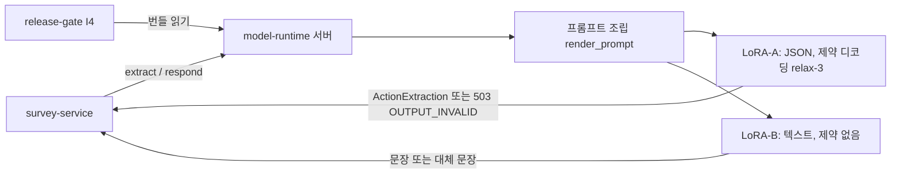

# model-runtime

문진 챗봇이 쓰는 두 개의 작은 언어 모델(LoRA-A 추출, LoRA-B 응답)을 불러와 같은 방식으로 호출해 주는 공유 라이브러리이자 추론 서버다.

환자 발화에서 "무슨 뜻인지"를 구조화해 뽑는 일(A, `extract`)과, 정해진 재료로 환자에게 할 문장을 만드는 일(B, `respond`)을 맡는다. 학습 후 평가, 승인 평가, 실제 서비스가 같은 프롬프트·디코딩으로 모델을 부르게 하는 것이 목적이다(docs/brief.md). 하지 않는 것: 학습(model-lab), 모델 보관과 승인(release-gate), 서비스 서버(survey-service), 판단 로직(turn-engine). 모델이 판단하게 만드는 프롬프트도 두지 않는다. 출처: docs/brief.md.

## 전체 속의 위치

| 이웃 | 방향 | 무엇을 | 인터페이스 |
| --- | --- | --- | --- |
| survey-service | 받음/줌 | 호출 요청을 받고 `ActionExtraction`(A) 또는 문장(B)을 돌려줌 | I9, HTTP.md I9: `POST /v1/releases/{id}/extract`, `.../respond` |
| release-gate | 받음 | 승인된 릴리스 번들(어댑터, 설정)을 읽음 | I4(`HttpReleaseReader`), `PUT /v1/releases/{id}`로 적재 |
| model-lab | 받음 | 학습된 어댑터와 모델 패키지(매니페스트) | 어댑터 디렉터리, `ModelPackageManifest` |
| boundary-contracts | 의존 | 입출력 스키마, 해시, `read_secret` | 태그 v2.0.2 (docs/boundary.md) |
| 문진 스키마 | 의존 | 정수 버전 1 확인 | `schema_dir` 읽기 전용 |

호출자가 입력 JSON의 키 순서를 지켜야 하는 등 규칙은 docs/boundary.md "호출자가 지켜야 할 것"에 있다.

## 구조

| 경로 | 역할 |
| --- | --- |
| `src/model_runtime/session.py`, `prompts.py`, `serving_config.py` | `load`, 세션(extract/respond), 프롬프트 조립, 서빙 설정과 해시 |
| `src/model_runtime/backends.py`, `vllm_backend.py` | 가짜 백엔드와 vLLM 백엔드(제약 디코딩) |
| `src/model_runtime/protection.py`, `fallback.py`, `schema_guard.py`, `errors.py` | 출력 보호, 대체 문장, 스키마 검사, 예외 |
| `src/model_runtime/server.py` | HTTP 추론 서버 |
| `profiles/` | 하드웨어별 설정: `gpu-12g.json`, `rtx4090-24g.json`, `gpu-dev-12g.json`(Qwen2.5-1.5B, 중립 어댑터·파이프라인 시험 전용, 파일의 `status`) |
| `tests/`, `scripts/` | 시험(가짜 백엔드·vLLM 모킹 포함), 스모크와 GPU 점검 스크립트 |
| `Dockerfile`, `requirements-{cpu,gpu}.lock` | 이미지 두 변형(CPU/fake, GPU/vLLM)과 잠금 파일 |



제약 디코딩 `relax-3`은 A의 출력 스키마를 xgrammar가 받을 수 있게 같은 뜻의 `anyOf`로 펼친 방식이다(docs/STATUS.md 19차). 프로파일: `gpu-12g`는 Qwen3-1.7B(파이프라인 데모용), `rtx4090-24g`는 Qwen3-8B(docs/boundary.md).

## 실행 방법

전제: 파이썬 3(venv), 시험만 할 때는 GPU 불필요. 이미지 빌드·스모크는 Docker와 형제 폴더 `../boundary-contracts`(태그 v2.0.2)가 필요하다. GPU 실행은 NVIDIA 드라이버와 `--gpus`가 필요하다. 비밀은 값이 아니라 파일 경로(`MODEL_RUNTIME_TOKENS_FILE`, `MODEL_RUNTIME_RELEASE_TOKEN_FILE`)로 받는다(D84, docs/runbook.md).

```bash
# 1) 설치 (docs/runbook.md "개발 시험")
python3 -m venv .venv
.venv/bin/pip install pytest jsonschema "git+ssh://git@github.com/Sdabin1209/openit_boundary-contracts.git@v2.0.2" -e .
# 2) 시험
.venv/bin/python -m pytest -q
# 3) 이미지 빌드와 스모크 (CPU/fake, 빈 포트를 Docker가 배정)
scripts/smoke.sh
# 4) 서버 (이미지 없이). 스키마 경로가 필요하다
MODEL_RUNTIME_SCHEMA_DIR=<.../survey-service/schema/schemas> MODEL_RUNTIME_BACKEND=fake \
  MODEL_RUNTIME_RELEASE_URL=<release-gate 주소> .venv/bin/python -m model_runtime.server
```

이 세션에서 실제로 돌린 것: `.venv/bin/python -m pytest --collect-only -q`(154개 수집), `.venv/bin/python -m model_runtime.server --help`(스키마 경로가 필요하다는 안내가 나왔고 서버는 뜨지 않음). 돌리지 않은 것: 시험 실행, `scripts/smoke.sh`, 이미지 빌드, 서버 기동, GPU 관련 전부. 4번의 환경 변수 조합은 runbook 표를 옮긴 것이며 직접 기동해 확인하지 않았다.

## 현재 상태

문서 기준 버전은 0.7.2(docs/STATUS.md 22차). 확인된 것:
- 14차(0.6.0) 시험 109 통과/0 실패, CPU 이미지 빌드와 스모크 통과(`/healthz`, `/readyz`, 라벨, non-root). 123 통과는 15차(0.6.1)의 값이다(docs/STATUS.md).
- 20차(0.7.0)의 시험·스모크 결과는 STATUS에 숫자가 없다. 이 세션의 수집 개수 154는 통과 수가 아니다.
- relax-3: 원본/변환 스키마 판정 등가, xgrammar 컴파일 경고 없음(CPU, STATUS 19차). gpu-dev에서 extract 48회 모두 형식 통과(OPEN_GAPS U04, 헤드 기록).
- gpu-dev 12GB에서 Qwen3-1.7B 적재, 약 10.1GB 사용(OPEN_GAPS U01, 헤드 기록).

확인 못 한 것(문서 기준): 학습된 4B/8B 어댑터의 GPU 적재, `rtx4090-24g`의 Qwen3-8B 적재, 실제 어댑터를 GPU에서 얹는 절차(STATUS 20차). 이 세션에서는 위 숫자를 다시 재현하지 않았다.

## 이 영역의 열린 항목 (head/docs/OPEN_GAPS.md, 읽기 전용으로 확인)

| ID | 내용 | 막는 것 |
| --- | --- | --- |
| G04 | respond 대체 문장의 재료 없음 문구가 잠정 | 사용자(도메인 소유자) 확인 |
| G05 | v1 G1(응답 숫자 검사)에 해당하는 검사를 둘지 미정 | 결정 필요(담당 표기 없음) |
| G09 | model-lab의 `tests/golden/`가 남아 있음(이 영역은 제거 완료) | 다른 영역(model-lab) |
| U01 | 12GB에서 A·B 동시 부하와 장시간 안정성, 프로파일 값 반영 | GPU 실측 |
| U03 | 서빙 프롬프트와 학습 글자 일치: 토큰 ID 대조, 채팅 템플릿 설정, `<think>` 처리 | 다른 영역(학습 서버 코드)·GPU |
| U04 | 제약 디코딩의 컴파일 비용, `minItems`/`maxItems` 강제 여부 | GPU 실측 |

## 더 자세한 문서

| 문서 | 내용 |
| --- | --- |
| docs/brief.md | 영역의 목적, 경계, 수용 기준, GPU 호스트 규칙 |
| docs/boundary.md | 제공 API(I9), 소비 계약, 호출자가 지킬 것, 장애 영향 |
| docs/design.md | 내부 설계, 출력 보장 방식(O14), GPU 시험 기록(§11) |
| docs/runbook.md | 환경 변수, 이미지, 컴포즈, LoRA 교체, 증상별 확인 |
| docs/STATUS.md | 차수별 한 일, 확인한 것과 못 한 것 |
| docs/rules.md | 출력 보호 규칙 |
| docs/prompt-review.md | 프롬프트 역할 분리 점검 목록 |
| docs/CHANGELOG.md | 변경 이력 |
| docs/change-requests/ | 헤드에게 보낸 변경 요청 001~004 |
